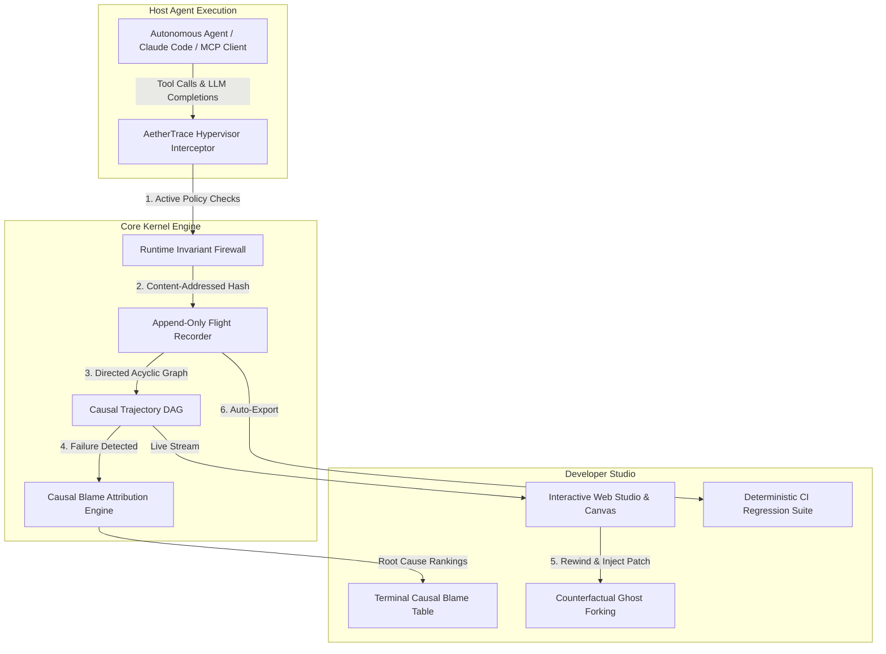

# AetherTrace 🧭⚡

> **Deterministic Causal Hypervisor, Time-Travel Debugger, and Invariant Verification Engine for Autonomous AI Agents.**

[](#)
[](#)
[](LICENSE)
[](#)

---

## 💡 The Post-AI Engineering Thesis

In the post-2025 AI era, boilerplate code generation (CRUD APIs, basic frontends, generic RAG wrappers) has been commoditized. Foundation models write standard application code faster than humans. 

**What will guarantee software engineering jobs and command top-tier compensation even after AGI?**

The answer is **System Reliability, Formal Invariants, and Causal Observability for Stochastic Systems**. 

When enterprises deploy autonomous agents across production databases, cloud infrastructure, and internal APIs, **over 80% of workflows fail** due to cascading non-determinism:
* **The "Step 3" Poison Pill:** An unparsed 404 response or subtle schema shift at Step 3 corrupts the agent's context, but the catastrophic failure only triggers at Step 48.
* **Non-Reproducibility:** You cannot reproduce agent failures because temperature, GPU batching, and external APIs drift.
* **The Token Burn Abyss:** Debugging requires re-running the entire 50-step run, burning \$20-\$50 in tokens per attempt.
* **Security & Injection Vulnerabilities:** Tool outputs can smuggle prompt injections or execute destructive shell commands without authorization.

**AetherTrace is the missing hypervisor layer for AI agents.** It operates as an eBPF-style execution kernel: recording immutable content-addressed event graphs, calculating mathematical causal blame attribution, enabling interactive zero-token time-travel replay, and auto-synthesizing deterministic CI regression tests from production failures.

---

## 🏛️ Architecture Overview



---

## ✨ Key Capabilities

### 1. 🔍 Causal Blame Localization Engine
Instead of dumping 200,000 tokens of raw text, AetherTrace builds a Directed Acyclic Graph (DAG) of the agent's reasoning trajectory and computes counterfactual blame across upstream nodes:

$$\text{Blame}(v_i) = w_1 \cdot \text{Proximity}(v_i, F) + w_2 \cdot \text{Centrality}(v_i) + w_3 \cdot \text{AnomalySignal}(v_i)$$

It instantly isolates the exact tool return or chain-of-thought premise that introduced the failure with actionable remedies:
```
CAUSAL BLAME ATTRIBUTION REPORT:
──────────────────────────────────────────────────────────────────────
#1 Step 5: execute_shell [TOOL_CALL]
   Blame: 80.0% | Centrality: 0.3333 | Entropy: 0.7143
   Terminal failure manifested directly at Step 5 (execute_shell).
   💡 Recommended Remedy: Inspect tool parameters for 'execute_shell'.

#2 Step 3: read_logs_output [TOOL_OBSERVATION]
   Blame: 62.3% | Centrality: 0.3333 | Entropy: 0.4143
   Step 3 returned an anomalous 500 socket payload that causally propagated into execute_shell at Step 5.
   💡 Recommended Remedy: Sanitize return schema of tool 'read_logs' before model context.
```

### 2. ⏳ Zero-Token Time-Travel & "Ghost Forking"
* **Timeline Scrubbing:** Step backward and forward through any historical trajectory.
* **Deterministic Ghost Mocking:** Replay steps $0 \dots k-1$ with **0 tokens** and **0 network I/O** using verified SHA-256 content hashes.
* **Counterfactual Forking:** Patch a tool return or prompt at Step $k$ and observe downstream execution branching in real-time.

### 3. 🛡️ Active Runtime Invariant Firewall ("eBPF for Agents")
Active policy enforcement that intercepts and vetoes harmful agent behaviors before execution:
* **Workspace Path Confinement:** Halts file reads/writes outside designated boundaries (e.g., blocks `~/.ssh/id_rsa`, `/etc/passwd`).
* **Indirect Prompt Injection Scanner:** Detects delimiter hijacking and instructions smuggled into tool observations.
* **Loop Deadlock Governor:** Terminates repetitive, infinite tool loops before burning tokens.
* **Destructive Command Veto:** Intercepts unrecoverable shell commands (`rm -rf /`, `DROP DATABASE`).

### 4. 🧪 Automatic Trace-to-CI Test Synthesizer
With one command:
```bash
node --experimental-strip-types src/cli/index.ts synth traces/demo_failure.atrace --output tests/regression.test.ts
```
AetherTrace automatically generates a complete, 100% deterministic Node.js test file that mocks all external tool side-effects and verifies agent state in CI pipelines.

### 5. 🖥️ Interactive Web Canvas Studio
Launch a self-contained local web dashboard with zero external dependencies:
```bash
node --experimental-strip-types src/cli/index.ts inspect traces/demo_failure.atrace
```
* Interactive Causal DAG visualizer with node zoom and inspection.
* Timeline slider to scrub through agent execution step-by-step.
* Causal Blame heatmaps and Invariant audit status.

---

## 🚀 Quickstart

### Prerequisites
* **Node.js v24+** (utilizes native TypeScript execution via `--experimental-strip-types` — **zero compile step and zero external node_modules needed!**)

### Run the Interactive Demo
Experience an end-to-end agent failure, causal blame localization, security invariant veto, time-travel fork, and CI test generation:
```bash
npm run demo
```

### Run Tests
```bash
npm test
```
All 21 comprehensive unit, property-based, and end-to-end simulation tests execute in under 1 second!

### CLI Commands
```bash
# Analyze causal blame of a failure trace
npm run blame traces/demo_failure.atrace

# Launch the interactive web inspector
npm run inspect traces/demo_failure.atrace

# Synthesize a deterministic regression test
node --experimental-strip-types src/cli/index.ts synth traces/demo_failure.atrace --output tests/my_regression.test.ts
```

---

## 📂 Project Structure

```
aethertrace/
├── bin/
│   └── aethertrace.js             # Global executable runner
├── src/
│   ├── types/
│   │   └── index.ts               # Domain types (TrajectoryNode, CausalEdge, InvariantRule)
│   ├── utils/
│   │   └── hash.ts                # Deterministic SHA-256 & canonical JSON serialization
│   ├── core/
│   │   ├── causal-graph.ts        # Directed Acyclic Graph builder & topological analysis
│   │   ├── blame-engine.ts        # Causal blame attribution & counterfactual analysis
│   │   ├── firewall.ts            # Runtime invariant monitor & policy firewall
│   │   ├── recorder.ts            # Content-addressed append-only flight recorder (.atrace)
│   │   └── time-travel.ts         # Zero-token ghost replay & counterfactual branching
│   ├── proxy/
│   │   └── mcp-proxy.ts           # Model Context Protocol (MCP) transparent stdio proxy
│   ├── synthesizer/
│   │   └── test-generator.ts      # Trace-to-CI regression test generator
│   ├── ui/
│   │   └── dashboard-generator.ts # Self-contained interactive HTML/Canvas visual studio
│   └── cli/
│       └── index.ts               # Unified command-line interface
├── tests/                         # 21 comprehensive test suites
├── traces/                        # Serialized .atrace execution bundles
└── README.md
```

---

## 💼 Why This Stands Out in Tech Interviews

When engineering managers ask: *"AI can write code now, why should we hire you?"*

You point to AetherTrace:
1. **Systems Foundations:** Implements low-level process instrumentation, stdio proxying, and content-addressed immutable event stores (similar to Git and Docker internals).
2. **Graph Theory & Causal Modeling:** Demonstrates mastery of Directed Acyclic Graphs (DAGs), Kahn's topological sort, betweenness centrality, and counterfactual blame attribution.
3. **Solving the #1 Crisis in Enterprise AI:** Shows deep understanding of why LLM agents fail in production and provides the exact verification, containment, and regression infrastructure that companies (Anthropic, DeepMind, Stripe, OpenAI) are actively hiring for.
4. **Developer Experience (DX):** Demonstrates full product craftsmanship with an instant CLI, terminal tables, and an embedded browser canvas studio with zero friction.

---

## 📄 License
Apache-2.0 © AetherTrace Team.
