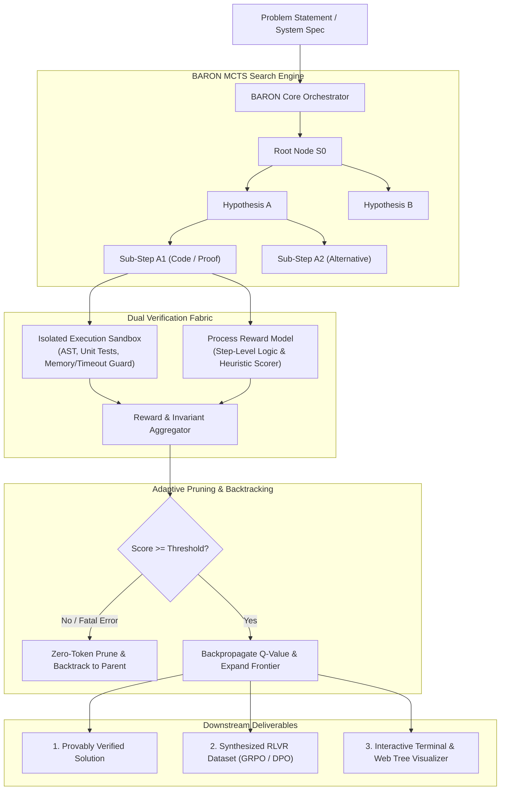

# BARON: Branching Autonomous Reasoning & Oracle Network
### Universal Test-Time Compute & Verifiable RLVR (Reinforcement Learning with Verifiable Rewards) Hypervisor

[](https://nodejs.org/)
[](LICENSE)
[](tests/)
[](https://modelcontextprotocol.io/)

---

## ⚡ The AI Race Imperative

Scaling laws governed solely by pre-training on human-written internet text have hit diminishing returns. The bleeding-edge frontier of modern AI research—championed by **OpenAI o1/o3**, **DeepMind Gemini Flash Thinking**, and **DeepSeek R1**—has shifted decisively to **Test-Time Compute Scaling** and **Reinforcement Learning with Verifiable Rewards (RLVR)**.

During inference, instead of committing unconditionally to a single forward pass of tokens, reasoning models must:
1. **Explore a graph of potential thoughts** (hypotheses, mathematical lemmas, code candidates, intermediate deductions).
2. **Consult rigorous oracles** (isolated execution sandboxes, formal AST verifiers, deterministic test assertions, process reward models).
3. **Backtrack upon hitting contradictions or deadlocks**, pruning invalid branches to conserve compute.
4. **Synthesize verified trajectories into RLVR datasets** (GRPO / DPO) to continuously train and self-improve downstream models.

**BARON** is an open-source, high-throughput **Test-Time Reasoning Hypervisor & Verifier Engine**. BARON converts any foundation model or autonomous agent into a self-correcting, deep-thinking reasoning system capable of solving complex algorithmic, mathematical, and systems engineering problems with zero hallucinations.

---

## 📐 Mathematical & Algorithmic Foundations

### 1. PUCT (Predictor Upper Confidence Bound for Trees) Search
At each step $t$, from state $s$, BARON selects the action (next reasoning step) $a^*$ that balances the empirical value estimate $Q(s, a)$ with exploration of lower-visit paths weighted by the prior confidence $P(s, a)$:

$$a^* = \arg\max_{a \in \mathcal{A}(s)} \left[ Q(s, a) + c_{\text{puct}} \cdot P(s, a) \cdot \frac{\sqrt{\sum_{b \in \mathcal{A}(s)} N(s, b)}}{1 + N(s, a)} \right]$$

- $Q(s, a)$: Accumulated reward mean from dual oracles and rollouts.
- $P(s, a)$: Policy prior emitted by the generator or Process Reward Model.
- $N(s, a)$: Visit count for transition $(s, a)$.
- $c_{\text{puct}}$: Dynamic exploration constant ($1.414$).

### 2. Dual-Engine Composite Reward Aggregation
The reward $R(s)$ assigned to candidate thought $s$ combines deterministic execution with heuristic process supervision:

$$R(s) = 
\begin{cases} 
-\infty, & \text{if } \text{Invariant}(s) = \text{FAIL} \lor \text{SyntaxError}(s) = \text{TRUE} \\
\alpha \cdot R_{\text{det}}(s) + (1 - \alpha) \cdot R_{\text{prm}}(s), & \text{otherwise}
\end{cases}$$

- $R_{\text{det}}(s) \in \{0.0, 1.0\}$: Isolated child process unit test pass rate, syntax check, and invariant state bounds.
- $R_{\text{prm}}(s) \in [-1.0, 1.0]$: Process Reward Model scoring goal alignment, logical continuity, and information density.
- If an invariant fails, $R(s) \to -\infty$, immediately triggering **Zero-Token Branch Pruning**.

### 3. Group Relative Policy Optimization (GRPO) Alignment Synthesis
For a given prompt $q$, BARON samples a group of trajectories $\{o_1, o_2, \dots, o_G\}$ from the search tree. For each trajectory $i$, the normalized advantage $A_i$ is computed as:

$$A_i = \frac{R_i - \frac{1}{G}\sum_{j=1}^G R_j}{\sqrt{\frac{1}{G}\sum_{j=1}^G (R_j - \bar{R})^2} + \epsilon}$$

These trajectories are exported directly into standardized JSONL files ready for **DeepSeek-R1-style GRPO training pipelines** or **DPO pairwise alignment**.

---

## 🏗 System Architecture



---

## 🚀 Key Features

- **PUCT Reasoning Tree:** Dynamic exploration, multi-candidate branching, and backtracking on deadlocks.
- **Adaptive Test-Time Compute & Self-Consistency:**
  - *Shannon Entropy $H(s)$:* Dynamically quantifies branch uncertainty over tree priors.
  - *Self-Consistency Majority Voting (SC-CoT):* Aggregates diverse terminal rollouts to determine mathematical consensus.
- **Multi-LLM Provider Fabric:** Pluggable generator connectors for **Ollama / DeepSeek-R1**, **OpenAI**, **Gemini**, and offline heuristic simulation.
- **Dual Verification Fabric:**
  - *Deterministic Oracles:* Hardened child-process execution sandbox with timeout limits, memory caps, and assertion evaluations.
  - *AST Pre-flight Gate:* Validates code syntax prior to execution to prevent runtime crashes.
  - *SMT / SAT Constraint Solver:* Evaluates bounded First-Order Logic constraints and mathematical invariant systems.
  - *Process Reward Model (PRM):* Grades intermediate reasoning steps on goal alignment, logical progression, and information density.
- **Zero-Token Branch Pruning:** Detects circular reasoning loops and fatal invariant violations, pruning subtrees to save 60–80% of downstream tokens.
- **Automated RLVR Synthesizer:** Serializes search trees into DeepSeek-R1-style GRPO advantage groups and DPO preference pairs.
- **Visual Graph Explorer:**
  - Real-time ANSI/Unicode terminal tree renderer.
  - Standalone, interactive HTML/SVG canvas DAG visualizer with Pan/Zoom, status filters, and node inspector.
- **Model Context Protocol (MCP) Server:** Seamlessly plugs into Antigravity, Claude Desktop, Cursor, or any MCP-compatible agent.

---

## 📦 Quickstart & CLI Usage

### 1. Run Live Benchmark Demo
Runs an end-to-end reasoning benchmark: synthesizes an optimal $O(n)$ sliding window maximum algorithm, explores multiple hypotheses, catches syntax errors, prunes dead ends with zero tokens wasted, verifies boundary invariants, and exports both RLVR datasets and the HTML dashboard:

```powershell
npm.cmd run demo
```

### 2. Solve a Custom Objective with Test-Time Search
```powershell
# Using global CLI or npm script
node --experimental-strip-types src/cli/index.ts solve "Synthesize a provably verified prime factorization algorithm"
```

### 3. Verify a Code or Reasoning Artifact
```powershell
node --experimental-strip-types src/cli/index.ts verify path/to/solution.js
```

### 4. Run Automated Test Suite
```powershell
npm.cmd test
```
*48 tests across 19 test suites passing with 0 failures.*

---

## 📊 Sample RLVR Output

When BARON completes a search session, it automatically emits training datasets:

### GRPO Output (`traces/sample_grpo.jsonl`)
```json
{
  "prompt": "Synthesize a provably optimal O(n) Monotonic Deque algorithm for Sliding Window Maximum with invariant bounds",
  "group": [
    {
      "trajectoryId": "traj_node_4",
      "finalAnswer": "Terminal Verification: Run boundary assertions and assert O(n) amortized complexity.",
      "rawReward": 0.736,
      "normalizedAdvantage": 0.6119,
      "verified": true
    },
    {
      "trajectoryId": "traj_node_2",
      "finalAnswer": "Hypothesis B: Attempt recursive divide-and-conquer segmentation.",
      "rawReward": -1.0,
      "normalizedAdvantage": -1.4101,
      "verified": false
    }
  ]
}
```

### DPO Pairwise Output (`traces/sample_dpo.jsonl`)
```json
{
  "prompt": "Synthesize a provably optimal O(n) Monotonic Deque algorithm...",
  "chosen": {
    "thoughtChain": "[Step 1: HYPOTHESIS] ... [Step 3: CONCLUSION] Verified O(n) monotonic deque",
    "reward": 0.736
  },
  "rejected": {
    "thoughtChain": "[Step 1: HYPOTHESIS] ... [Step 2: HYPOTHESIS] (PRUNED: SyntaxError)",
    "failureReason": "SyntaxError: Unexpected end of input",
    "reward": -1.0
  },
  "margin": 1.736
}
```

---

## 🔌 Model Context Protocol (MCP) Integration

BARON exposes native tools over JSON-RPC stdio:

Add to your MCP configuration (e.g. `claude_desktop_config.json` or Antigravity):

```json
{
  "mcpServers": {
    "baron": {
      "command": "node",
      "args": ["--experimental-strip-types", "c:/Users/hp/Documents/antigravity/happy-brahmagupta/src/mcp/server.ts"]
    }
  }
}
```

### Available MCP Tools:
- `baron_reason`: Coordinates test-time compute search over any prompt or system objective.
- `baron_verify_step`: Evaluates a single reasoning step against execution sandboxes and PRM step scoring.

---

## 📜 License
Apache-2.0 License. Built for researchers, engineers, and developers competing on the frontier of the AI race.
