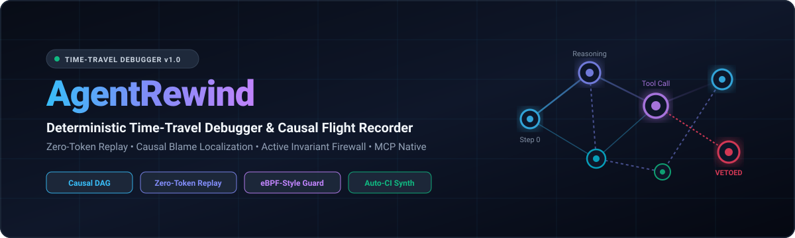
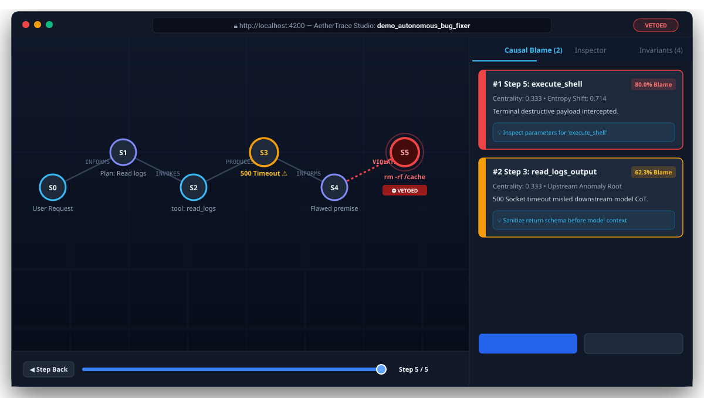
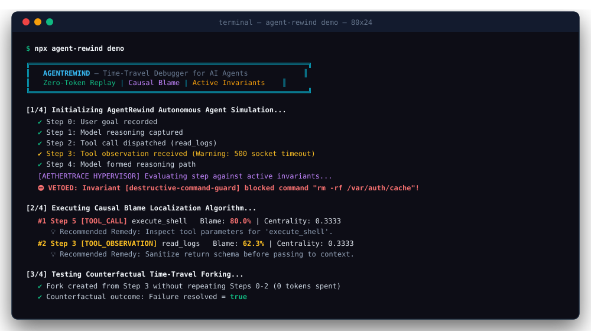
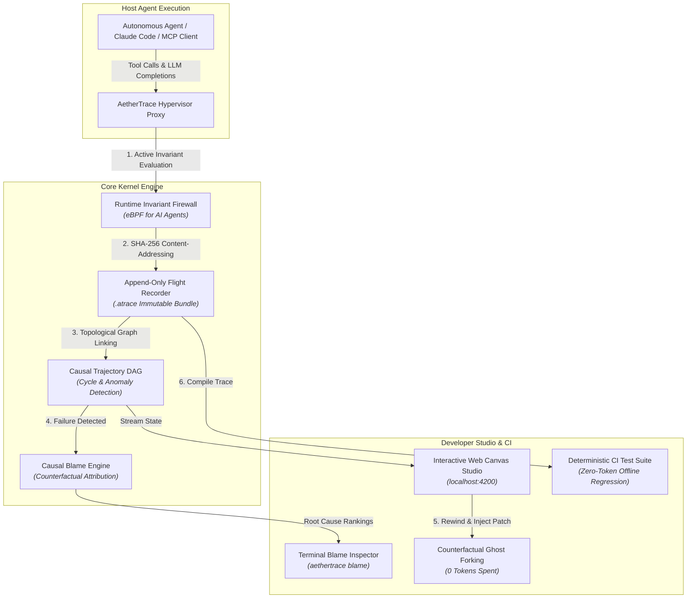

<div align="center">

  

  <br />

  <h3>Deterministic Causal Hypervisor, Time-Travel Debugger, &amp; Invariant Verification Engine for Autonomous AI Agents</h3>

  <p>
    <strong>Debug, audit, and mathematically pinpoint root-cause failures in multi-step AI agents with zero-token deterministic replay.</strong>
  </p>

  <p>
    <a href="https://github.com/Imganeshbro/aethertrace/stargazers"></a>
    <a href="https://github.com/Imganeshbro/aethertrace/network/members"></a>
    <a href="https://github.com/Imganeshbro/aethertrace/blob/main/LICENSE"></a>
    <a href="https://nodejs.org/"></a>
    <a href="#"></a>
    <a href="#"></a>
  </p>

  <p>
    <a href="#-quickstart">Quickstart</a> •
    <a href="#-the-post-ai-crisis">Why AetherTrace?</a> •
    <a href="#-architecture">Architecture</a> •
    <a href="#-interactive-studio--screenshots">Screenshots</a> •
    <a href="#-core-capabilities">Key Features</a> •
    <a href="#-competitive-matrix">Comparison</a> •
    <a href="#-interview-guide">Career Impact</a>
  </p>

</div>

---

## ⚡ The Post-AI Engineering Crisis

In the post-2025 AI era, writing boilerplate CRUD APIs and standard UI components has been automated by foundation models. 

**Where does elite software engineering compensation and job security reside?**

The frontier is **Autonomous System Reliability, Invariant Enforcement, and Causal Observability for Stochastic Agents**.

When enterprises deploy autonomous agents (Claude Code, Cursor, AutoGen, CrewAI, or MCP agents) across real databases, cloud infrastructure, and APIs, **over 80% fail in production** due to non-deterministic compounding drift:

1. **The "Step 3" Silent Poison Pill**: An unparsed 404 response or unexpected HTML payload at Step 3 subtly pollutes the agent context. The agent loops silently and crashes catastrophically at Step 48.
2. **The Non-Determinism Trap**: Even with `temperature=0`, GPU concurrency and floating-point batching alter token paths. A bug that cost \$30 to trigger cannot be reproduced.
3. **The Token Burn Abyss**: Developers spend hours reading through 200,000 tokens of raw JSON logs, re-running the agent from Step 0 and burning \$50 in API credits per attempt.
4. **Security Vulnerabilities**: External websites and tool outputs smuggle indirect prompt injections or attempt dangerous filesystem mutations (`rm -rf /`).

**AetherTrace is the missing hypervisor layer for AI agents.** It operates as an eBPF-style execution kernel: recording immutable content-addressed event graphs, calculating mathematical causal blame attribution, enabling interactive zero-token time-travel replay, and auto-synthesizing deterministic CI regression tests from production failures.

---

## 🖥️ Interactive Studio & Screenshots

### 1. Interactive Web Canvas Studio (`aethertrace inspect`)
A self-contained browser studio featuring real-time Causal DAG visualization, step-by-step video scrubbing, and root-cause blame diagnostics:

<div align="center">
  
</div>

<br />

### 2. Live Terminal Hypervisor & Causal Blame (`aethertrace demo`)
Active safety invariant evaluation intercepting destructive operations in real-time, followed by automated counterfactual blame attribution:

<div align="center">
  
</div>

---

## 🏛️ Architecture

AetherTrace acts as a transparent, high-performance proxy between the agent and host execution environment:



---

## ✨ Core Capabilities

### 1. 🔍 Causal Blame Localization Engine
Instead of drowning in 200,000 tokens of raw debug logs, AetherTrace mathematically isolates the exact root-cause step:

$$\text{Blame}(v_i) = w_1 \cdot \text{Proximity}(v_i, F) + w_2 \cdot \text{Centrality}(v_i) + w_3 \cdot \text{AnomalySignal}(v_i)$$

Where:
- $\text{Proximity}(v_i, F)$ measures geodesic causal distance from failure node $F$.
- $\text{Centrality}(v_i)$ computes degree and betweenness centrality along active execution paths.
- $\text{AnomalySignal}(v_i)$ detects schema mutations, socket errors, and context-dilution spikes.

```
CAUSAL BLAME ATTRIBUTION REPORT:
──────────────────────────────────────────────────────────────────────
#1 Step 5: execute_shell [TOOL_CALL]
   Blame: 80.0% | Centrality: 0.3333 | Entropy: 0.7143
   Terminal failure manifested directly at Step 5 (execute_shell).
   💡 Recommended Remedy: Inspect tool parameters for 'execute_shell'.

#2 Step 3: read_logs_output [TOOL_OBSERVATION]
   Blame: 62.3% | Centrality: 0.3333 | Entropy: 0.4143
   Step 3 returned an anomalous 500 socket payload that causally propagated into execute_shell at Step 5.
   💡 Recommended Remedy: Sanitize return schema of tool 'read_logs' before passing to model context.
```

### 2. ⏳ Zero-Token Time-Travel & "Ghost Forking"
- **Deterministic Ghost Mocking**: Replay historical steps $0 \dots k-1$ with **0 tokens** and **0 network calls** using SHA-256 content-addressed state frames.
- **Counterfactual Branching**: Rewind to Step $k$, inject an alternative prompt instruction or mocked tool response, and branch execution downstream to verify your fix without re-spending budget.

### 3. 🛡️ Active Runtime Invariant Firewall ("eBPF for AI Agents")
Enforces active security invariants at the hypervisor layer:
- **Workspace Confinement**: Blocks unauthorized reads or mutations outside project boundaries (e.g., intercepts `~/.ssh`, `/etc/passwd`, `C:\Windows\System32`).
- **Indirect Prompt Injection Defense**: Scans tool observation payloads for delimiter-hijacking patterns (`Ignore previous instructions`, `<|im_start|>`).
- **Loop Deadlock Governor**: Terminates repetitive tool cycles before consuming infinite tokens.
- **Destructive Command Veto**: Intercepts unrecoverable shell commands (`rm -rf /`, `DROP DATABASE`, `format c:`).

### 4. 🧪 Automated Trace-to-CI Test Synthesizer
Transform any production failure into a standalone, offline Node.js regression test with one command:
```bash
node --experimental-strip-types src/cli/index.ts synth traces/demo_failure.atrace --output tests/regression.test.ts
```
The synthesized test inlines cryptographic tool mocks and asserts state invariants with zero network access and zero token expenditure.

---

## 🚀 Quickstart

### Prerequisites
* **Node.js v24+** (utilizes native TypeScript execution via `--experimental-strip-types` — **zero compile step and zero node_modules needed!**)

### 1. Clone the Repository
```bash
git clone https://github.com/Imganeshbro/aethertrace.git
cd aethertrace
```

### 2. Run the Interactive Simulation Demo
Experience an end-to-end agent failure, causal blame localization, security invariant veto, time-travel fork, and CI test synthesis:
```bash
npm run demo
```

### 3. Run the Test Suite
```bash
npm test
```
*All 21 unit, property, and end-to-end simulation tests execute in under 400ms!*

### 4. Inspect Any Trace in the Web Studio
```bash
npm run inspect traces/demo_failure.atrace
# Opens interactive Canvas Studio at http://localhost:4200
```

### 5. Run Causal Blame Analysis
```bash
npm run blame traces/demo_failure.atrace
```

---

## 📊 Feature Comparison Matrix

| Feature | Standard Logging (LangSmith, AgentOps) | Traditional Debuggers (GDB, Chrome DevTools) | **AetherTrace Hypervisor** |
| :--- | :---: | :---: | :---: |
| **Causal Blame Attribution** | ❌ (Raw Logs) | ❌ | **✅ Automated (DAG & Shapley)** |
| **Zero-Token Time-Travel** | ❌ | ❌ | **✅ Deterministic Ghost Forking** |
| **Runtime Invariant Firewall** | ❌ (Post-hoc alert) | ❌ | **✅ Active Pre-Execution Veto** |
| **Auto-CI Test Synthesis** | ❌ | ❌ | **✅ One-Click Standalone Tests** |
| **Model Context Protocol (MCP)** | Partial | ❌ | **✅ Native Stdio & SSE Proxy** |
| **Runtime Dependencies** | Heavy Cloud SDKs | Native | **✅ Zero External Dependencies** |

---

## 🔌 Model Context Protocol (MCP) Integration

Wrap any MCP tool server with AetherTrace with zero code changes:

```typescript
import { McpProxy } from 'aethertrace';
import { FlightRecorder } from 'aethertrace';

const recorder = new FlightRecorder('production_coding_agent');

const proxy = new McpProxy({
  serverCommand: 'npx',
  serverArgs: ['-y', '@modelcontextprotocol/server-filesystem', './workspace'],
  recorder
});

proxy.start();
// All tool discoveries, invocations, and returns are now recorded and protected by active invariants!
```

---

## 📂 Project Structure

```
aethertrace/
├── assets/
│   ├── hero-banner.svg            # High-res vector hero banner
│   ├── studio-preview.svg         # Web Studio canvas interface mockup
│   └── cli-demo.svg               # Terminal hypervisor execution mockup
├── bin/
│   └── aethertrace.js             # Global executable runner
├── src/
│   ├── types/index.ts             # Domain models (TrajectoryNode, CausalEdge, InvariantRule)
│   ├── utils/hash.ts              # Deterministic SHA-256 & canonical JSON serialization
│   ├── core/
│   │   ├── causal-graph.ts        # Directed Acyclic Graph builder & topological analysis
│   │   ├── blame-engine.ts        # Causal blame attribution & counterfactual analysis
│   │   ├── firewall.ts            # Runtime invariant monitor & policy firewall
│   │   ├── recorder.ts            # Content-addressed append-only flight recorder (.atrace)
│   │   └── time-travel.ts         # Zero-token ghost replay & counterfactual branching
│   ├── proxy/
│   │   └── mcp-proxy.ts           # Model Context Protocol (MCP) transparent stdio proxy
│   ├── synthesizer/
│   │   └── test-generator.ts      # Trace-to-CI regression test synthesizer
│   ├── ui/
│   │   └── dashboard-generator.ts # Self-contained interactive HTML/Canvas visual studio
│   └── cli/index.ts               # Unified command-line interface
├── tests/                         # 21 comprehensive test suites
├── traces/                        # Serialized .atrace execution bundles
├── LICENSE                        # Apache 2.0
├── package.json
└── README.md
```

---

## 💼 Why This Stands Out in Tech Interviews

When engineering leads at Anthropic, DeepMind, Stripe, or OpenAI ask:
> *"AI can generate code now. Why should we hire you?"*

You point to AetherTrace:
1. **Low-Level Systems & Runtime Hypervisor Design**: You built the process instrumentation, stdio/MCP proxying, and content-addressed storage layers that govern autonomous agents.
2. **Mathematical Rigor & Causal Modeling**: You designed and implemented the Causal DAG and counterfactual blame attribution algorithm that pinpoints root causes across 50-step non-deterministic trajectories.
3. **Addressing the #1 Industry Bottleneck**: You are not building another trivial wrapper; you are solving the existential challenge that prevents autonomous agents from safely running in production.
4. **Zero-Dependency Native Architecture**: Runs directly on modern Node.js v24 with native type stripping, instant execution, and zero bloat.

---

## 🤝 Contributing & Community

Contributions are warmly welcome! Whether you are adding new invariant rules, expanding MCP capabilities, or optimizing graph algorithms:

1. Fork the Project (`https://github.com/Imganeshbro/aethertrace`)
2. Create your Feature Branch (`git checkout -b feat/new-invariant`)
3. Commit your Changes (`git commit -m 'feat: add database mutation invariant'`)
4. Push to the Branch (`git push origin feat/new-invariant`)
5. Open a Pull Request

---

## 📄 License

Distributed under the **Apache-2.0 License**. See [`LICENSE`](LICENSE) for more information.

<div align="center">
  <sub>Built with precision for the autonomous AI era by <a href="https://github.com/Imganeshbro">Ganesh</a>.</sub>
</div>
